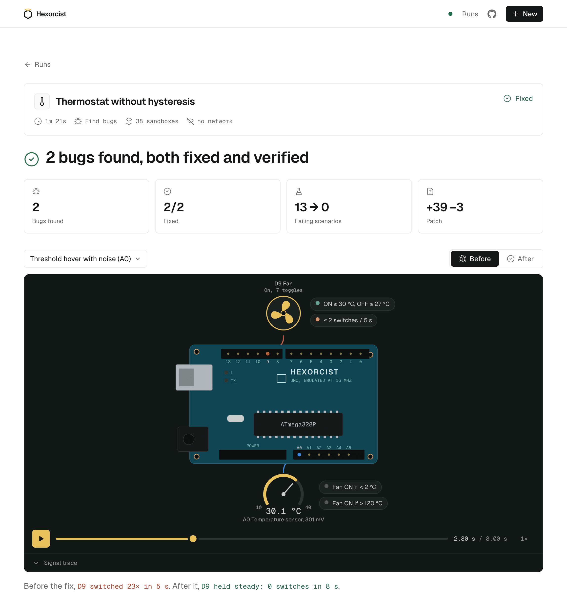
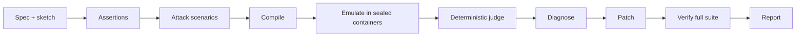
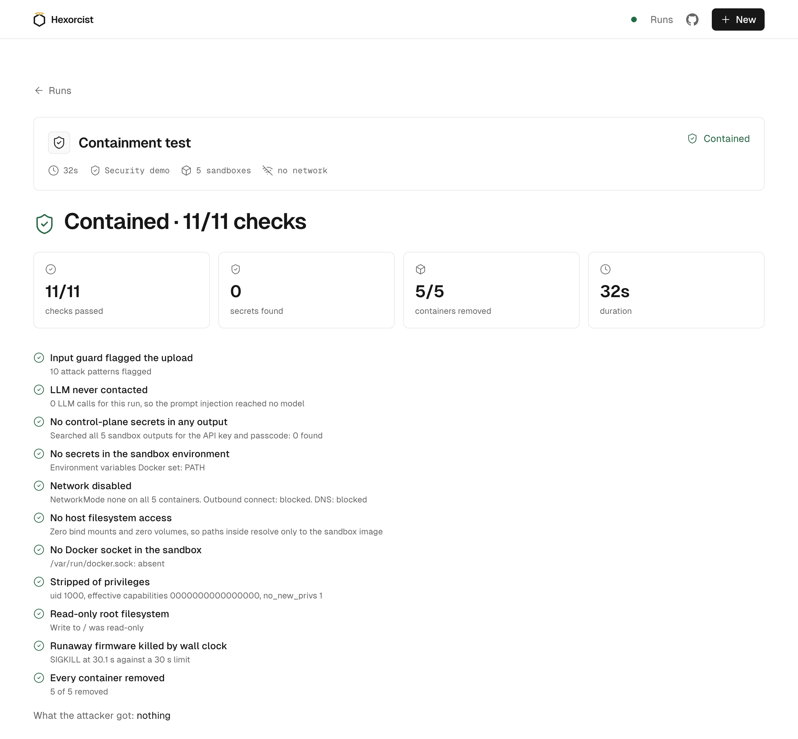
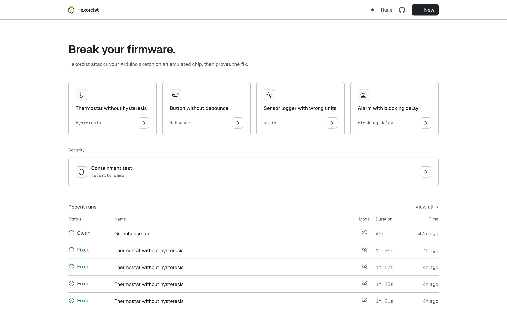
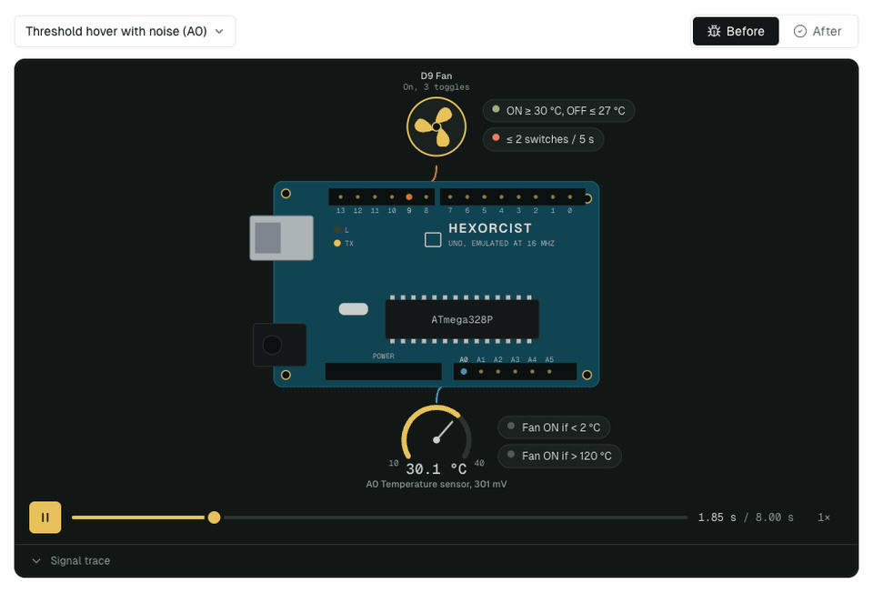
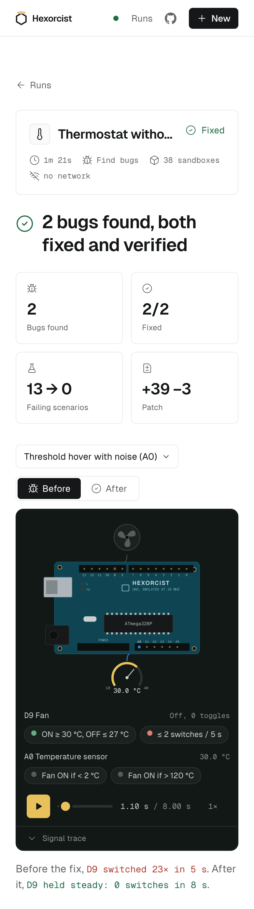

<p align="center">
  <picture>
    <source media="(prefers-color-scheme: dark)" srcset="frontend/public/brand/hexorcist-dark.svg" />
    
  </picture>
</p>

<h1 align="center">Hexorcist</h1>

<p align="center">An AI agent that attacks Arduino firmware on an emulated chip, then proves its own fix.</p>

<p align="center">
  
</p>

## Why

Firmware bugs like a fan that chatters at a threshold or a button that double-toggles often compile cleanly and look plausible when you only read the sketch. A code review can guess; Hexorcist compiles the firmware, runs it on an emulated chip under adversarial inputs, and measures what happened.

## What it does

- Finds bugs by compiling the sketch and running it under adversarial conditions on an emulated ATmega328P.
- Reports measured evidence from the emulator trace, for example `D9 toggled 23 times in a 5000 ms window (limit 2)`.
- Writes a minimal patch and only calls the run fixed after re-running the full scenario suite with nothing new broken.
- Write firmware mode: generates a sketch from a description, then has to survive the same attacks before it is accepted.

## How it works



**The model proposes; the engine judges.**

The LLM invents assertions, scenarios, root-cause notes, and patches. Every pass or fail comes from plain Python that evaluates the harness JSON against those assertions. Evidence strings are built from pin events and serial logs, not from model text. A model cannot talk a failure into a pass, and a fix is claimed only when the same judge re-runs the whole suite on the patched firmware.

## Results

Three runs of each buggy preset through the live API on 2026-11-14, model `deepseek-chat` (DeepSeek), via `python -m scripts.run_presets --repeat 3`. Out of 3 runs per preset, all 12 reached a verified fix. Containment was run once (11/11 checks). Scenario names and patch sizes still vary because the model designs part of the attack.

| Preset | Bug type | Bugs found | Fixed and verified (runs) | Median time |
| --- | --- | ---: | ---: | ---: |
| Thermostat without hysteresis | No hysteresis; no sensor fault check | 2 | 3/3 | 116 s |
| Button without debounce | No debounce | 1 | 3/3 | 43 s |
| Sensor logger with wrong units | Wrong unit conversion | 1 | 3/3 | 79 s |
| Alarm with blocking delay | Blocking `delay()` | 3 | 3/3 | 59 s |
| Containment test | Hostile upload | — | 1/1 (11/11 checks) | 32 s |

## Benchmark

Hexorcist is measured on two sets of firmware cases, both in `bench/`:

- **v2 (`bench/cases/`):** 40 frozen cases, 29 with planted bugs (32 bugs in all) and 11 correct sketches. Each has a plain-English spec and deterministic checks.
- **Practice set (`bench/practice/`):** 10 cases with harder bugs that show up only under the right conditions (a clock near its rollover, a press at the wrong moment, a high reading): 7 with a planted bug and 3 correct decoys that look suspicious.

**Both sets have been seen and tuned on. These are development numbers, not evidence about firmware the agent has not been shaped around.** A held-out set, written and frozen before the agent runs on it, is the next step and does not exist yet. The cases and answer keys were written with an AI coding assistant, then checked with a lint (no hint words in comments, every check tied to a spec bullet) and by running each reference sketch through every check.

### v2, 40 cases

| System | Recall (32 bugs) | Honest recall | False alarms | Verified fix (29 buggy) | Cost of the 40 cases |
| --- | ---: | ---: | ---: | ---: | ---: |
| Plain review, DeepSeek | 32/32 (100%) | n/a | 81 | 27/29 (93%) | $0.027 |
| Plain review, gpt-4o-mini | 28/32 (88%) | n/a | 53 | 14/29 (48%) | $0.024 |
| Hexorcist, first run (2026-11-15) | 31/32 (97%) | 26/32 (81%) | 27 | 27/29 (93%) | $0.241 |
| Hexorcist, latest (`dev_full5`, 2026-11-18) | 30/32 (94%) | 28/32 (88%) | 5 | 26/29 (90%) | $0.201 |

Recall counts the planted bugs that a report was matched to (matching is judged by `gpt-4o-mini`). Honest recall counts a detection only if the matched check fails on the buggy sketch in a scenario where the known-good reference passes, so a check that no correct firmware passes does not count. It is computed for Hexorcist only. False alarms are strict: every report that matches no planted bug, on all 40 cases. Verified fix is the share of the 29 buggy cases whose patch passes the frozen checks. The plain reviews make no fix claim of their own, so theirs is the result of the patch they wrote. Hexorcist runs `deepseek-chat`, plus `gpt-4o-mini` for the second clean room. Cost leaves out the judge, about $0.006 per scoring.

### Practice set, 10 cases

| System | Recall (7 bugs) | Honest recall | False alarms (7 bugs + 3 decoys) | Verified fix (7 buggy) | Cost of the 10 cases |
| --- | ---: | ---: | ---: | ---: | ---: |
| Plain review, DeepSeek | 7/7 (6 defensible) | n/a | 13 | 5/7 | $0.0064 |
| Plain review, gpt-4o-mini | 3/7 (2 defensible) | n/a | 16 | 0/7 | $0.0054 |
| Hexorcist, latest (`dev_practice2`) | 6/7 | 4/7 | 3 | 4/7 | $0.052 |

"Defensible" leaves out judge matches whose report does not name the planted cause (`bench/practice/README.md` lists them).

### What this shows

Against a plain review, Hexorcist reports far fewer false alarms: 5 on v2 against 81 for DeepSeek and 53 for gpt-4o-mini, and 3 on the practice set against 13 and 16. Its verified-fix rate (90%) is about that of the DeepSeek review (93%) and well above gpt-4o-mini's (48%), and every fix it claims was checked by re-running the suite (22 of 22 claims passed the frozen checks), which a review cannot do. Its recall (94%) is now close to the plain DeepSeek review (100%) but not above it, on both sets. The price is cost and time: about 7 times the cost of a plain review ($0.20 against $0.027 for the 40 cases) and roughly 100 seconds per case instead of 4 to 10 seconds.

### Known limits

- **One run per column.** The checks are regenerated from the spec on every run, so single cases move from run to run with no change to the agent; treat a difference of one or two cases as noise.
- **Honest recall exists only for Hexorcist.** The plain-review recall is as the judge matched it and was not checked against the reference; on the practice set two of those matches do not name the planted cause.
- **Correlated clean-room errors.** The clean rooms are two sketches written from the spec alone; when both misread the same spec fact they drop a real check. This happened on `glue_solenoid_short` and `silo_fill_gauge`, and a prompt change (each room lists the spec facts first) fixed both. It can happen again on a spec fact the list does not catch.
- **Cases it still misses.** On v2, `hold_to_arm_late` and the second bug of `panel_dual_debounce_edge`. On the practice set, `cold_store_alarm` in the latest run, and `orchard_spray_valve` and `tank_mixer_cycle` only through checks that the reference also fails.
- **The stimulus search found nothing.** In 300 variants on the practice set no variant broke a check that had not already failed. It is off by default. The clock fast-forward in the attack plan exposed two bugs in earlier runs, but whether it does depends on the model placing a press just before a wrap.
- **Remaining false alarms** include two checks no correct firmware passes (`blend_tank_sum_ovf` a2, `loft_fan_ok` a3) and three where the reference passes the check.
- **False alarms are counted against the planted-bug key.** A report about a real but unplanted problem still counts as a false alarm. The reference sketches pass every check, which limits that risk but does not remove it.

### Reproduce

Runs need a DeepSeek key (`LLM_*`) and an OpenAI key (`OPENAI_*`, for clean room 2 and the judge) in `.env`, and Docker. `bench/run_dev.sh` rebuilds the stack, refuses to start if it is set up differently, and resumes the last run unless `RUN_ID` is given.

```bash
RUN_ID="dev_full_$(date -u +%Y%m%dT%H%M%SZ)" bench/run_dev.sh                  # all 40 v2 cases: about $0.20, about 80 minutes
RUN_ID="dev_practice_$(date -u +%Y%m%dT%H%M%SZ)" bench/run_dev.sh --dir practice   # the practice set: about $0.05, about 17 minutes
RUN_ID="dev_practice_search_$(date -u +%Y%m%dT%H%M%SZ)" bench/run_dev.sh --dir practice --search   # the same with the stimulus search on
```

Then score, replay on the references and compare (add `--dir practice` for the practice set):

```bash
backend/.venv/bin/python -m bench.score --run-id RUN_score --hexorcist bench/results/RUN_hexorcist.json
backend/.venv/bin/python -m bench.replay_run RUN
backend/.venv/bin/python -m bench.dev_compare dev_full5_20261118T051737Z RUN
```

The plain reviews: `backend/.venv/bin/python -m bench.run_baseline --endpoint llm` (DeepSeek) and `--endpoint openai` (gpt-4o-mini), scored with `bench.score --baseline`. Results and the run-by-run comparison are in `bench/results/dev_comparison.md`.

### Related work

LLM-driven firmware testing in an emulator is not new. [arXiv 2509.09970](https://arxiv.org/abs/2509.09970) has LLMs generate firmware, tests it in QEMU with fuzzing, static analysis and runtime monitoring, and loops patches back through the model; its focus is security flaws (buffer overflows, races, denial of service). [EmbedBench](https://arxiv.org/abs/2506.11003) (the EmbedAgent paper) benchmarks how well LLMs write, design and migrate embedded code, scored by pass@1 on 126 cases. [Wokwi](https://wokwi.com) and [simavr](https://github.com/buserror/simavr) are simulators that run firmware you test with checks you write; Hexorcist runs on simavr. What Hexorcist adds is behaviour checks derived from a plain-English spec and judged in plain Python, with analog noise and contact bounce injected into the emulated pins, a clean-room oracle (firmware written from the spec alone) to tell a bug from a check no correct firmware passes, fixes accepted only after the whole suite re-runs, and a benchmark that counts false alarms and compares against the known-good reference. It has not been run against those systems, and none of this shows it finds more bugs than they do.

## Sandbox

Every compile and every scenario run gets a fresh container that is always removed afterwards. Limits (from `backend/app/sandbox.py` and `backend/app/config.py`):

- `--network none` / `network_disabled`
- empty environment (no secrets)
- `cap_drop: ALL`, `no-new-privileges:true`
- non-root `USER 1000:1000` in the image
- read-only root filesystem
- tmpfs `/work` and `/tmp` (`noexec,nosuid,nodev`, 128 MiB)
- memory 512 MiB, no swap; 1 CPU; `pids_limit` 128
- wall-clock kill: compile 60 s, emulate 30 s
- Docker socket never mounted into a sandbox

<p align="center">
  
</p>

The containment demo is a hostile sketch and a prompt-injection spec. It never calls the LLM; the measured run above passed 11/11 checks in 32 s.

## Prompt-injection guard

`screen_request` combines regex rules with a shipped TF-IDF + logistic regression classifier (`backend/app/guard_model.json`). On the held-out test set (`ml/results.json`, `ml/README.md`):

- regex alone: **10%** recall on new attack styles
- regex + TF-IDF: **39.4%** recall on new styles, **3.4%** FPR, ~**2.2 ms** p50 per upload

A fine-tuned MiniLM scored higher recall but flagged **17%** of real Arduino library sketches at its threshold (and ~214 ms p50), so it was not shipped. The guard still misses most attacks; the sandbox is the real boundary.

## Compared to

- **A plain LLM code review.** The same model can flag likely bugs by reading the sketch. It cannot measure them on a trace or re-run a patch. The Compare tab puts that review next to Hexorcist's measured evidence on a Break run.
- **Wokwi and simavr.** Useful simulators and CI runners when you write the tests yourself. Hexorcist sits on top of simavr: it turns a plain-English spec into checks, invents attacks, and verifies its own patch.

## Screenshots

<p align="center">
  
</p>

<p align="center">
  
</p>

<p align="center">
  
</p>

## Run it locally

Prerequisites: Docker with Compose v2.

```bash
git clone https://github.com/MatthewKim07/hexorcist.git
cd hexorcist
cp .env.example .env
# Set LLM_BASE_URL, LLM_API_KEY, and LLM_MODEL to any OpenAI-compatible endpoint.
# Compose builds the sandbox image (arduino-cli + simavr), then the backend and frontend.
docker compose up --build
```

Open [http://localhost:8080](http://localhost:8080) (or the port in `HEXORCIST_PORT`). `GET /api/health` should return `"ok": true`. Without an API key the UI still loads; Break/Build runs that need the model will fail until one is set. The containment preset does not need a model.

## Tech stack

- **Frontend:** React, Vite, TypeScript, Tailwind
- **Backend:** FastAPI, SQLite, SSE
- **Sandbox:** per-task Docker containers, `arduino-cli` inside
- **Emulator:** simavr + custom AVR harness (`sandbox/harness`)
- **ML:** regex + TF-IDF / logistic regression guard (stdlib inference)

## Limitations

- Arduino Uno (ATmega328P) only
- Sensors modelled as pin voltages; no I2C or SPI peripherals
- Prompts tuned mainly on one chat model
- Emulation runs about **1.3× faster than real time** on one core (8 s of firmware time in ~6 s; `scripts/measure_speed`); long scenarios must still fit the 30 s wall-clock kill
- The input guard catches under half of held-out attacks

## License

[MIT](LICENSE)
