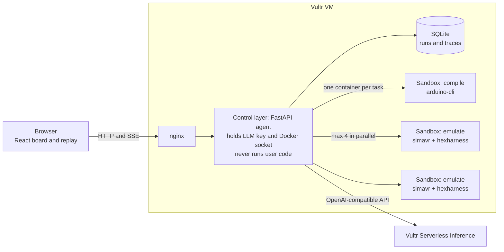

# Hexorcist

**Cast the bugs out of your firmware.**

An AI QA engineer that tries to break your firmware, on an emulated chip, in a sealed sandbox.

Arduino firmware compiles to a `.hex` file. Hexorcist drives the bugs out of it.

## What it does

Upload an Arduino sketch and describe, in plain English, how it is wired and what it should do. Hexorcist then:

1. **Understands** the spec and turns your requirements into machine-checkable assertions.
2. **Compiles** your real firmware in a throwaway sandbox.
3. **Plans an attack**: the agent invents adversarial scenarios for your code, on top of a built-in library (threshold noise, glitch spikes, disconnected and floating sensors, rail-to-rail values, button bounce, rapid oscillation).
4. **Executes** every scenario against the compiled binary on an emulated ATmega328P, in parallel, one disposable container each.
5. **Diagnoses** each failure, citing code lines and measured evidence.
6. **Fixes** the sketch with a minimal patch.
7. **Verifies** by recompiling and re-running the full suite, up to 3 times. A fix is only claimed if everything that failed now passes and nothing new broke.
8. **Reports** bugs with evidence, root cause, a diff, and a before/after replay on an animated virtual board.

There are two modes. **Break** attacks firmware you already have. **Build** writes firmware from a description, then has to survive the same attack before it can declare success.

## Why running it beats reading it

An LLM reading your code says "this might chatter." Hexorcist runs it and measures it. These are real results from the planted bugs in the preset projects, with verdicts computed from the emulator trace:

| Preset | Planted bug | What the emulator measured |
| --- | --- | --- |
| Possessed thermostat | No hysteresis | `D9 toggled 23 times in a 5000 ms window (limit 2), and 30 times over the whole 8.00 s run` |
| Possessed thermostat | No sensor fault check | `During the fault, D9 was not in safe state HIGH for 5000 ms` |
| Bouncing button | No debounce | `toggle counts per press were [4, 4, 4, 4]` |
| Lying logger | Wrong unit conversion | `printed 230.74 °C while the injected input was 300.0 °C: off by 69.3 °C` |
| Comatose alarm | Blocking `delay()` | `went silent for 3000 ms`, and `missed 2 of 4 triggers` |

**The model proposes, and the engine judges.** The LLM writes assertions, attacks, explanations and patches. It never decides whether anything passed. Every verdict and evidence string comes from deterministic Python evaluating the trace, so a model cannot talk a failure into a pass. If the spec could not be turned into checks, the result is `inconclusive`, never `clean`.

## Architecture



- `sandbox/`: the image with arduino-cli, the arduino:avr core, simavr, and `hexharness`, a C program linked against libsimavr. It injects analog voltages, digital levels, bounce and floating pins from a JSON scenario, then records serial, pin changes, PWM duty and exit reason in simulated time.
- `backend/`: the FastAPI control layer, the agent pipeline, the assertion engine and the sandbox runner.
- `frontend/`: React, Vite, TypeScript, Tailwind, CodeMirror and Recharts.

## Containment design

All user-supplied and AI-written code compiles and runs only inside per-task containers, never in the backend or on the host. The UI reports these limits as read back from `docker inspect`, not as requested.

| Limit | Why |
| --- | --- |
| Fresh container per compile and per scenario, always removed | Nothing survives between runs, so one upload cannot affect another |
| `--network none` | Nothing to exfiltrate through, no metadata service, no callback |
| Empty environment, no secrets | The LLM key and passcode exist only in the control layer, and every sandbox output is searched for them afterwards |
| `cap_drop: ALL` | No kernel capabilities to abuse |
| `no-new-privileges` | setuid binaries cannot raise privileges |
| Non-root user (uid 1000) | Least privilege inside the container |
| Read-only root filesystem | The toolchain and harness cannot be modified |
| tmpfs `/work` and `/tmp`, `noexec,nosuid,nodev`, 128 MiB | Scratch space only, gone at exit, and nothing written there can be executed |
| No bind mounts and no volumes | Host paths simply do not exist inside |
| Memory 512 MiB, no swap | Stops memory bombs, reported as an OOM kill |
| 1 CPU | One task cannot starve the others |
| `pids_limit: 128` | Stops fork bombs |
| Wall-clock limits: compile 60 s, emulation 30 s, then SIGKILL | Firmware and compiler cannot run forever, and the kill is enforced from outside the container |
| Docker socket never mounted into a sandbox | That would be root on the host |

**The trust boundary is the control layer.** It holds the Docker socket, which is root-equivalent on the host, plus the LLM key. It only launches sandboxes and never compiles or executes user code itself. Emulated firmware has a second wall as well: it is AVR code in simavr, not a native process.

Inputs enter as a tar on stdin, because a read-only rootfs rejects `put_archive` and tmpfs mounts do not exist until the container starts. Results leave as one JSON document on stdout.

### The containment demo

The fifth preset is a hostile upload: `#include "/etc/passwd"`, `"/proc/self/environ"`, `"~/.ssh/id_rsa"`, a prompt injection in the spec, and firmware that never stops. What happens:

- The input guard flags it, so **the LLM is never contacted**.
- It compiles anyway, in a sandbox. The compiler really does open `/etc/passwd` and `/proc/self/environ`, but they are the sandbox's own files: image default users and a few environment names. There is no SSH key to find. The report shows exactly what the attacker got.
- The runaway firmware runs with the simulated-time cap deliberately removed, so that only the external wall-clock limit can stop it. It is killed at 30 s. Normal scenarios stop at their simulated duration, and this one run is labelled as an exception in the UI.

The run ends with a pass or fail for each containment check, computed from Docker's inspection data and from a probe that runs inside the sandbox.

`backend/app/guard.py` is a deliberately small interface, `screen_request(firmware, spec) -> {allowed, score, reasons}`, using regex rules for now. The sandbox does not rely on it: containment has to hold even when the guard misses something.

## Setup

You need Docker with Compose. It builds natively on linux/arm64 and linux/amd64.

```bash
cp .env.example .env     # set LLM_BASE_URL, LLM_API_KEY, LLM_MODEL
docker compose up --build
```

Open http://localhost:8080 and pick a preset. The containment demo works without an API key. The first build takes a few minutes, since it compiles simavr and downloads the AVR toolchain.

Any OpenAI-compatible endpoint works, and switching is only an edit to `.env`. Prompts are built to survive weaker open models, with strict schemas, validation, and one automatic repair retry on malformed JSON.

### Environment

| Variable | Purpose |
| --- | --- |
| `LLM_BASE_URL`, `LLM_API_KEY`, `LLM_MODEL` | The LLM endpoint |
| `DEMO_PASSCODE` | If set, starting a run requires this passcode |
| `HEXORCIST_PORT` | Published port, default 8080 |
| `RATE_LIMIT_PER_HOUR` | Runs per IP address, default 20 |
| `MAX_ACTIVE_RUNS` | Concurrent runs, default 3 |

### Tests

```bash
cd backend
uv venv --python 3.12 .venv && uv pip install --python .venv/bin/python -r requirements.txt
.venv/bin/python -m pytest tests -q               # engine and API, no Docker or LLM needed
docker build -t hexorcist-sandbox:latest ../sandbox
.venv/bin/python -m scripts.verify_sandbox        # the harness and lockdown, on real firmware
.venv/bin/python -m scripts.check_presets         # planted bugs fail, reference fixes pass, no LLM
.venv/bin/python -m scripts.run_presets           # all presets through a running API
.venv/bin/python -m scripts.replay_reference RUN  # a stored run's scenarios against known-good firmware
```

A failure in `replay_reference` means a scenario, an assertion or the evaluator is unfair, because the firmware is known to be correct. Every engine change is checked both ways: correct firmware must pass, and planted bugs must still fail.

`tests/mock_llm.py` is a scripted OpenAI-compatible server for testing the pipeline without a key. Its replies are canned, so a run against it says nothing about a real model.

## Known limits

- Arduino Uno (ATmega328P) only, and sensors are modelled as voltages at the pin. There is no I2C or SPI peripheral emulation yet.
- simavr does not model pull-ups, so the harness drives undriven inputs from the port register.
- `analogWrite` is captured by reading timer registers, since simavr does not move the GPIO. PWM is reported as duty, not as a waveform.
- simavr silently wraps some out-of-bounds data writes rather than faulting, so a wild pointer is not always reported as a crash. Running off the end of flash and sleeping with interrupts off are detected.
- Emulation runs at about 1.4x to 1.8x realtime on one Apple Silicon core. Check scenario lengths against the 30 s limit on slower machines.
- The virtual board and chart show the first 8000 pin events of a run. Verdicts always use the full trace.

## Deploying on Vultr

Placeholder, to be completed.

1. Create a linux/amd64 Vultr VM with Docker and Compose, at least 4 vCPUs for 4 parallel sandboxes.
2. In `.env`, set `LLM_BASE_URL=https://api.vultrinference.com/v1`, your inference API key, a model from your subscription, and a `DEMO_PASSCODE`.
3. Run `docker compose up -d --build`, and put TLS in front of the published port.

## License

MIT. See [LICENSE](LICENSE).
