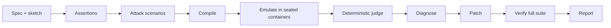

<p align="center">
  <picture>
    <source media="(prefers-color-scheme: dark)" srcset="frontend/public/brand/hexorcist-dark.svg" />
    
  </picture>
</p>

<h1 align="center">Hexorcist</h1>

<p align="center">An AI agent that attacks Arduino firmware on an emulated chip, then proves its own fix.</p>

<p align="center">
  
</p>

## What it does

- Finds bugs by compiling the sketch and running it under adversarial conditions on an emulated ATmega328P.
- Reports measured evidence from the emulator trace, for example `D9 toggled 23 times in a 5000 ms window (limit 2)`.
- Writes a minimal patch and only calls the run fixed after re-running the full scenario suite with nothing new broken.

## How it works



**The model proposes; the engine judges.**

The LLM invents assertions, scenarios, root-cause notes, and patches. Every pass or fail comes from plain Python that evaluates the harness JSON against those assertions. Evidence strings are built from pin events and serial logs, not from model text. A model cannot talk a failure into a pass, and a fix is claimed only when the same judge re-runs the whole suite on the patched firmware.

## Results

Stored runs against the five presets, model `deepseek-chat` (DeepSeek). The model designs part of the attack, so scenario names and exact timings vary run to run; the verdicts below do not.

| Preset | Bug type | Bugs found | Fixed and verified | Typical time |
| --- | --- | ---: | ---: | ---: |
| Thermostat without hysteresis | No hysteresis; no sensor fault check | 2 | 2 | ~85 s |
| Button without debounce | No debounce | 1 | 1 | ~40 s |
| Sensor logger with wrong units | Wrong unit conversion | 1 | 1 | ~74 s |
| Alarm with blocking delay | Blocking `delay()` | 3 | 3 | ~53 s |
| Containment test | Hostile upload | — | 11/11 checks | ~33 s |

Sources: compose DB runs `50117ab35f8e` (thermostat), `e42af353ac65` (button), `e0b0031ca150` (logger), `966d7c0d788d` (alarm), `9bb0859892d5` (containment).

## Sandbox

Every compile and every scenario run gets a fresh container that is always removed afterwards. Limits (from `backend/app/sandbox.py` and `backend/app/config.py`):

- `--network none` / `network_disabled`
- empty environment (no secrets)
- `cap_drop: ALL`, `no-new-privileges:true`
- non-root `USER 1000:1000` in the image
- read-only root filesystem
- tmpfs `/work` and `/tmp` (`noexec,nosuid,nodev`, 128 MiB)
- memory 512 MiB, no swap; 1 CPU; `pids_limit` 128
- wall-clock kill: compile 60 s, emulate 30 s
- Docker socket never mounted into a sandbox

<p align="center">
  
</p>

The containment demo is a hostile sketch and a prompt-injection spec. It never calls the LLM; the last stored run passed **11/11** checks in 33 s (`9bb0859892d5`).

## Prompt-injection guard

`screen_request` combines regex rules with a shipped TF-IDF + logistic regression classifier (`backend/app/guard_model.json`). On the held-out test set (`ml/results.json`, `ml/README.md`):

- regex alone: **10%** recall on new attack styles
- regex + TF-IDF: **39.4%** recall on new styles, **3.4%** FPR, ~**2.2 ms** p50 per upload

A fine-tuned MiniLM scored higher recall but flagged **17%** of real Arduino library sketches at its threshold (and ~214 ms p50), so it was not shipped. The guard still misses most attacks; the sandbox is the real boundary.

## Compared to

- **A plain LLM code review.** The same model can flag likely bugs by reading the sketch. It cannot measure them on a trace or re-run a patch. The Compare tab puts that review next to Hexorcist's measured evidence on a Break run.
- **Wokwi and simavr.** Useful simulators and CI runners when you write the tests yourself. Hexorcist sits on top of simavr: it turns a plain-English spec into checks, invents attacks, and verifies its own patch.

## Screenshots

<p align="center">
  
</p>

<p align="center">
  
</p>

<p align="center">
  
</p>

## Run it locally

Prerequisites: Docker (Compose v2).

```bash
cp .env.example .env
# Set LLM_BASE_URL, LLM_API_KEY, and LLM_MODEL to any OpenAI-compatible endpoint.
docker compose up --build
```

Open [http://localhost:8080](http://localhost:8080) (or the port in `HEXORCIST_PORT`).

## Tech stack

- **Frontend:** React, Vite, TypeScript, Tailwind
- **Backend:** FastAPI, SQLite, SSE
- **Sandbox:** per-task Docker containers, `arduino-cli` inside
- **Emulator:** simavr + custom AVR harness (`sandbox/harness`)
- **ML:** regex + TF-IDF / logistic regression guard (stdlib inference)

## Limitations

- Arduino Uno (ATmega328P) only
- Sensors modelled as pin voltages; no I2C or SPI peripherals
- Prompts tuned mainly on one chat model
- Emulation about 1.5× realtime on one Apple Silicon core; long scenarios must fit the 30 s wall-clock kill
- The input guard catches under half of held-out attacks

## License

[MIT](LICENSE)
