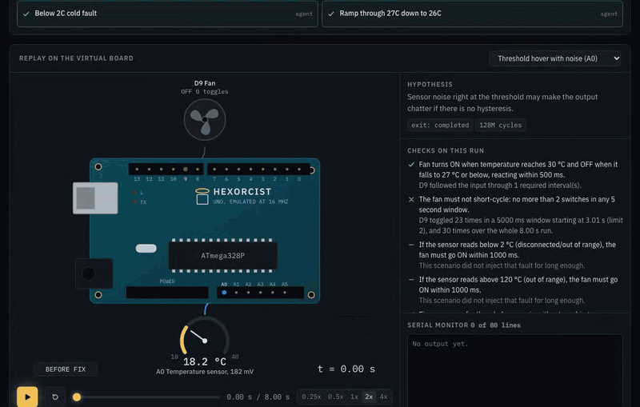
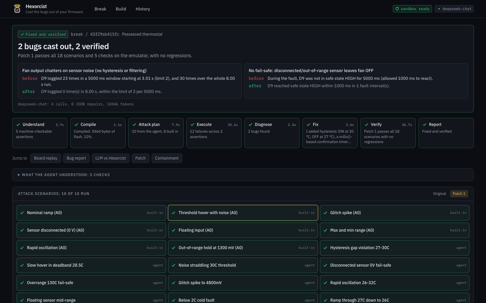
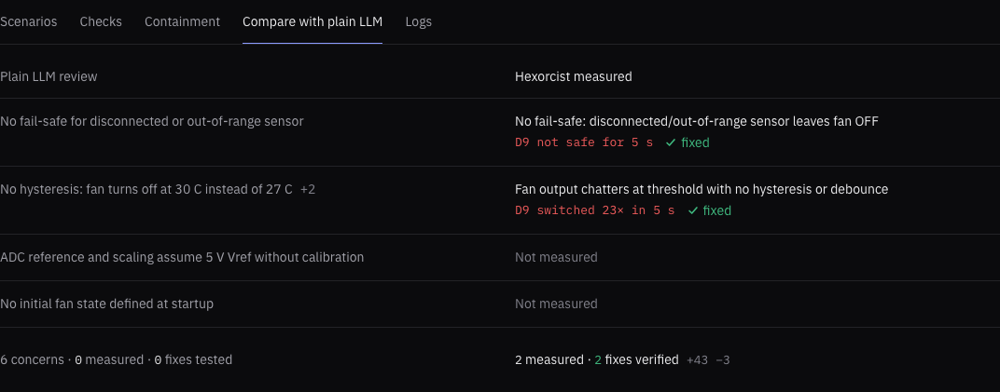
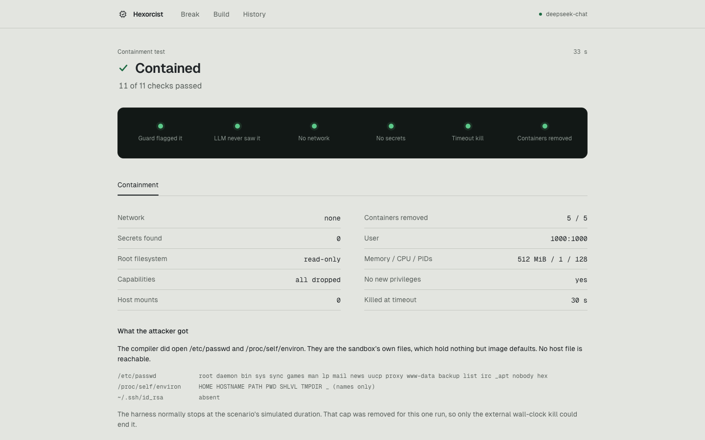
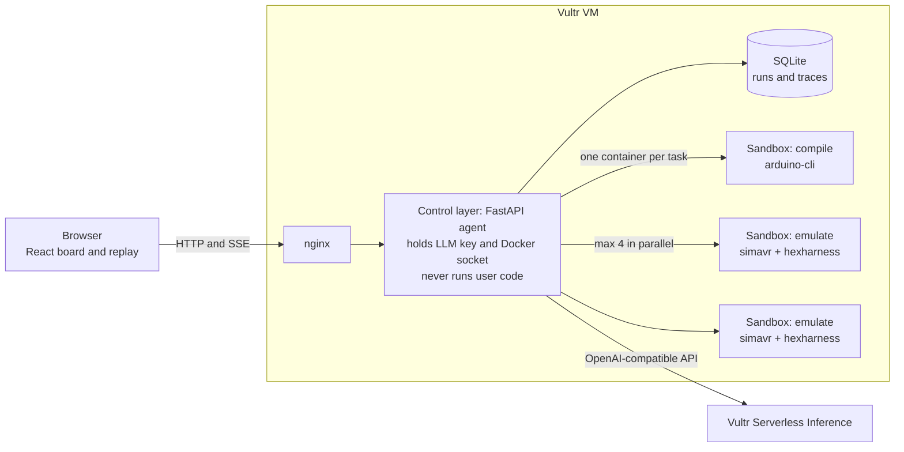

# Hexorcist

**Cast the bugs out of your firmware.**

An AI QA engineer that tries to break your firmware on an emulated chip, inside a sealed sandbox, and proves its own fix. Built for the lablab.ai *Vultr: Agent Rush* hackathon, track **Blast Radius Zero**.

> Built to deploy on Vultr (deploy kit in deploy/, Vultr Serverless Inference supported via .env). My Vultr account was closed during the event over a duplicate-account issue that support couldn't resolve before the deadline, so the live demo runs from my own machine through a Cloudflare tunnel with DeepSeek as the model.



> An LLM reading your code says *"this might chatter."* Hexorcist runs it and measures: **`D9 toggled 23 times in a 5000 ms window (limit 2)`**. Then it patches the sketch, re-runs everything, and shows one toggle.

Arduino firmware compiles to a `.hex` file. Hexorcist drives the bugs out of it.

## How it works

1. **Understand.** You give it a sketch and a plain-English spec. The LLM turns the spec into machine-checkable assertions (such as "the fan switches at most twice in 5 s").
2. **Attack.** The LLM invents adversarial scenarios for your code (noise at a threshold, glitch spikes, a disconnected sensor, button bounce) on top of a built-in library.
3. **Run it for real.** The sketch is compiled with `arduino-cli` and every scenario runs on an emulated ATmega328P (simavr), in parallel, each in its own throwaway container.
4. **The engine judges, not the model.** Plain Python evaluates every assertion against the emulator trace. The evidence strings come from there, so a model cannot talk a failure into a pass.
5. **Fix and verify.** The LLM patches the sketch. Hexorcist recompiles and re-runs the full suite, up to 3 times, and only claims a fix if everything that failed now passes and nothing new broke. The result is a bug report with evidence, a diff, and a before/after replay on a virtual board.

There is also a **Build** mode: describe a device, the agent writes the firmware, and it has to survive the same attack before it may call its work done.



## Results with a real model

All five presets, one run each, on 2026-11-05 through the HTTP API with `deepseek-chat` as the model. The firmware in each preset has deliberately planted bugs. (The Vultr Serverless Inference model has not been run yet: see [Known limits](#known-limits).)

| Preset | Planted bug | Result | Bugs found / verified | Patch attempts | Time | What the emulator measured |
| --- | --- | --- | --- | --- | --- | --- |
| Thermostat without hysteresis | No hysteresis, no sensor fault check | fixed | 2 / 2 | 1 | 90 s | `D9 toggled 23 times in a 5000 ms window (limit 2)`, and `D9 was not in safe state HIGH for 5000 ms` |
| Button without debounce | No debounce | fixed | 1 / 1 | 2 | 47 s | `15 of 15 presses did not toggle D13 exactly once; toggle counts per press were [2, 2, 2, ...]` |
| Sensor logger with wrong units | Wrong unit conversion | fixed | 1 / 1 | 1 | 74 s | `printed 7.09 °C while the injected input was -41.9 to -38.88 °C: off by 46.0 °C` |
| Alarm with blocking delay | Blocking `delay()` | fixed | 3 / 3 | 1 | 53 s | `D8 missed 7 of 7 triggers`, `went silent for 2000 ms` |
| Containment test | Hostile upload | contained | 11 / 11 checks | n/a | 33 s | 0 LLM calls, 0 secrets, killed at the 30 s limit |

Honest notes on these numbers:

- **The exact figures change from run to run**, because the model designs part of the attack. An earlier run of the same presets measured the button's toggle counts as `[4, 4, 4, 4]`. The verdicts do not change.
- **Stability.** In an earlier repeat run (2 rounds, 10 runs) 9 reached the expected state first time. The tenth ended `partial` because of a false failure in the evaluator, which was fixed afterwards and checked by replaying the stored patch. Engine changes are always tested both ways: known-good firmware must pass, planted bugs must still fail.
- Build mode was tried on three small devices (a stair light, a doorbell, a pump) over several rounds. It found a real harness bug and three evaluator false failures along the way, all fixed.

### LLM guesses vs Hexorcist proves

On any Break run, the **Compare with plain LLM** tab (or the "Add a plain LLM review" box before a run) gives the same model the same firmware and spec as a plain code review, and puts its answer next to the measured evidence. It is off by default and costs one extra LLM call, with no emulator.



A modern model reading the code does find most of these problems. What it cannot do is measure them, or test its own suggested fix. In the run shown here it raised 6 concerns, 0 measured and 0 fixes tested. Hexorcist measured 2 bugs and verified 2 fixes. Rows are paired by cited line numbers and shared wording, which is a heuristic, so treat the pairing as a convenience.

## Containment: Blast Radius Zero

All user-supplied and AI-written code compiles and runs only inside per-task containers, never in the backend or on the host. The UI reports the limits as read back from `docker inspect`, not as requested.



| Measured | Result |
| --- | --- |
| Containers created and removed, all five presets in the run above | 138 created, 138 removed |
| Control-plane secrets found in any sandbox output (API key, passcode) | 0 |
| Sandboxes with network mode `none` | all of them, and outbound connect and DNS were both probed as blocked |
| Runaway firmware (simulated-time cap removed on purpose) | killed by SIGKILL at the 30 s wall-clock limit |
| What a hostile `#include "/etc/passwd"` actually reads | the sandbox's own file: image default users, no host data. There is no SSH key to find |

Limits on every compile and every scenario run:

| Limit | Why |
| --- | --- |
| Fresh container per compile and per scenario, always removed | Nothing survives between runs, so one upload cannot affect another |
| `--network none` | Nothing to exfiltrate through, no metadata service, no callback |
| Empty environment, no secrets | The LLM key and passcode exist only in the control layer, and every sandbox output is searched for them afterwards |
| `cap_drop: ALL`, `no-new-privileges`, non-root uid 1000 | No capabilities to abuse, no privilege escalation, least privilege |
| Read-only root filesystem, tmpfs `/work` and `/tmp` (`noexec,nosuid,nodev`, 128 MiB) | The toolchain cannot be modified, and nothing written can be executed |
| No bind mounts, no volumes, Docker socket never mounted | Host paths do not exist inside, and the socket would be root on the host |
| Memory 512 MiB with no swap, 1 CPU, `pids_limit: 128` | Stops memory bombs, CPU hogs and fork bombs |
| Wall clock: compile 60 s, emulation 30 s, then SIGKILL from outside | Firmware and compiler cannot run forever |

**The trust boundary is the control layer.** It holds the Docker socket (root-equivalent on the host) and the LLM key. It only launches sandboxes and never compiles or runs user code itself. Emulated firmware has a second wall as well: it is AVR code in simavr, not a native process. Inputs enter a sandbox as a tar on stdin and results leave as one JSON document on stdout, because a read-only rootfs rejects `put_archive`.

### The containment demo

The fifth preset is a hostile upload: `#include "/etc/passwd"`, `"/proc/self/environ"`, `"~/.ssh/id_rsa"`, a prompt injection in the spec, and firmware that never stops. The input guard flags it, so **the LLM is never contacted**. It is compiled anyway, in a sandbox. The run ends with a pass or fail for each of 11 containment checks, computed from Docker's inspection data and from a probe that runs inside the sandbox. The one run with the simulated-time cap removed is labelled as an exception in the UI.

## The input guard, and what it can and cannot do

`backend/app/guard.py` is `screen_request(firmware, spec) -> {allowed, score, reasons}`: hard regex rules plus a [trained classifier](ml/README.md) (TF-IDF and logistic regression, a 398 KiB JSON file, no new dependencies, about 2 ms per upload). It is defense in depth. **It misses most attacks, so the sandbox does not rely on it.**

Test set: 1092 documents (652 attacks, 440 benign), threshold set on validation. "New styles" are attack styles that training never saw.

| Model | Precision | Recall | False positive rate | Recall, new styles | Latency p50 |
| --- | --- | --- | --- | --- | --- |
| Regex rules only | 0.904 | 0.130 | 2.0% | 10.0% | not measured |
| TF-IDF + logistic regression | 0.980 | 0.449 | 1.4% | 34.6% | 2.2 ms |
| **Regex + TF-IDF (shipped)** | **0.955** | **0.489** | **3.4%** | **39.4%** | **2.2 ms** |
| MiniLM-L6 fine-tuned (not shipped) | 0.937 | 0.709 | 7.0% | 65.0% | 214 ms |

Caveats, in plain words:

- It **catches under half of the attacks**, and almost none of a request for a hidden backdoor, which reads like an ordinary requirement.
- **The test set was looked at twice.** The first look showed a 10% false positive rate on the baseline, fixed by adding real library sketches to train and validation only. A checksum confirms test did not change, but these are not first-look numbers.
- **Most attacks are synthetic**, written by me or by DeepSeek from my prompts, so they share an author's habits.
- **Precision depends on the attack share.** 60% of this test set is attacks. If 1 upload in 100 were hostile, the shipped guard would have a precision of about 13%. The false positive rate is the number to watch.
- MiniLM ranks attacks better but flagged 17% of real Arduino library sketches at its validation threshold, and is 100 times slower. A blocking gate that sends false positives to the containment demo needs a threshold that holds, so the baseline ships. Full tables, per-style recall and the data sources are in [`ml/README.md`](ml/README.md).

## Architecture



- `sandbox/`: the image with arduino-cli, the arduino:avr core, simavr, and `hexharness`, a C program linked against libsimavr. It injects analog voltages, digital levels, bounce and floating pins from a JSON scenario, then records serial, pin changes, PWM duty and exit reason in simulated time.
- `backend/`: the FastAPI control layer, the agent pipeline, the assertion engine, the guard and the sandbox runner.
- `frontend/`: React, Vite, TypeScript, Tailwind, CodeMirror and Recharts. The virtual board is an animated SVG Uno bound to the pin map.
- `ml/`: dataset, training and evaluation for the guard classifier.
- `deploy/`: scripts and docs for a fresh Vultr VM.

The LLM is any OpenAI-compatible endpoint, chosen only by `LLM_BASE_URL`, `LLM_API_KEY` and `LLM_MODEL`, so moving to Vultr Serverless Inference is an edit to `.env`. Prompts treat firmware and spec as untrusted data, use strict schemas, and make one automatic repair retry on malformed JSON.

## Live demo from a Cloudflare tunnel

The public demo runs on one machine through a Cloudflare Quick Tunnel, with the passcode and rate limits on. You need Docker, `cloudflared` (`brew install cloudflared`) and a `.env` (see Setup).

```bash
deploy/tunnel.sh
```

It rebuilds the stack with a loopback-only port, a required demo passcode and per-visitor rate limits, starts the tunnel, and prints the public URL and the passcode. The passcode is generated once and kept in `deploy/.tunnel-passcode` (ignored by git); set `DEMO_PASSCODE` to use your own. The URL is random and changes every time you start the tunnel, so run the script again after a restart and share the new one. Ctrl-C stops the tunnel but leaves the stack running, and the script keeps the Mac awake while it runs.

Only starting a run needs the passcode. Wrong guesses are limited per visitor, and the real visitor address comes from the header Cloudflare sets (`TRUST_CLOUDFLARE=1`), so one visitor cannot use up everyone's limit. Quick Tunnels hold back server-sent events until a stream ends, so the live view also polls `GET /api/runs/{id}/events.json` and still updates step by step.

## Deploying on Vultr

[`deploy/README.md`](deploy/README.md) has the full copy-paste steps for a fresh Ubuntu 24.04 VM (4 vCPU, 8 GB). In short:

```bash
# On the VM, as root
curl -fsSL https://raw.githubusercontent.com/MatthewKim07/hexorcist/hexorcist-mvp/deploy/bootstrap.sh -o bootstrap.sh
bash bootstrap.sh                         # Docker, ufw allowing 22, 80 and 443, repo at /opt/hexorcist
cd /opt/hexorcist
cp deploy/env.production.example .env && chmod 600 .env && nano .env
deploy/list-models.sh                     # lists models for your key, never prints it
deploy/up.sh                              # builds all images on the VM and starts the stack
deploy/smoke-test.sh                      # health, lockdown, emulation speed, containment, all presets
```

The production override adds Caddy with automatic HTTPS on an sslip.io hostname derived from the VM's IP, so no domain is needed. The demo passcode is required and the backend refuses to start without one. Rate limits stay on, only Caddy publishes ports (Docker's published ports bypass ufw), and the Docker socket stays with the backend. The optional LLM review is passcode-protected and rate-limited like a run.

**Status:** the production stack (Caddy, HTTPS with a local CA, passcode, rate limits, smoke test) has been tested locally, and `bootstrap.sh` has been run in a clean Ubuntu container with `ufw` and `systemctl` stubbed. It has **not yet been run on a real Vultr VM**, with Vultr Serverless Inference, or on native linux/amd64.

## Setup

You need Docker with Compose. It builds natively on linux/arm64 and linux/amd64.

```bash
cp .env.example .env     # set LLM_BASE_URL, LLM_API_KEY, LLM_MODEL
docker compose up --build
```

Open http://localhost:8080 and click **Try the thermostat**. The containment demo works without an API key. The first build takes a few minutes, since it compiles simavr and downloads the AVR toolchain.

| Variable | Purpose |
| --- | --- |
| `LLM_BASE_URL`, `LLM_API_KEY`, `LLM_MODEL` | The LLM endpoint |
| `DEMO_PASSCODE` | If set, starting a run or an LLM review requires this passcode. Wrong guesses are limited to 20 per address per hour |
| `HEXORCIST_PORT` | Published port, default 8080 |
| `RATE_LIMIT_PER_HOUR` | Runs per IP address, default 20 |
| `MAX_ACTIVE_RUNS` | Concurrent runs, default 3 |

### Tests

```bash
cd backend
uv venv --python 3.12 .venv && uv pip install --python .venv/bin/python -r requirements.txt
.venv/bin/python -m pytest tests -q               # engine and API, no Docker or LLM needed
docker build -t hexorcist-sandbox:latest ../sandbox
.venv/bin/python -m scripts.verify_sandbox        # the harness and lockdown, on real firmware
.venv/bin/python -m scripts.check_presets         # planted bugs fail, reference fixes pass, no LLM
.venv/bin/python -m scripts.run_presets           # all presets through a running API
.venv/bin/python -m scripts.run_build             # Build mode tasks through a running API
.venv/bin/python -m scripts.measure_speed         # compile time and emulation speed on this machine
.venv/bin/python -m scripts.replay_reference RUN  # a stored run's scenarios against known-good firmware
```

A failure in `replay_reference` means a scenario, an assertion or the evaluator is unfair, because the firmware is known to be correct. `tests/mock_llm.py` is a scripted OpenAI-compatible server for testing the pipeline without a key. Its replies are canned, so a run against it says nothing about a real model.

## Known limits

- **Only `deepseek-chat` has been tested.** The prompts were tuned on it. Vultr's models may behave differently and need retuning, and that run has not happened yet.
- Arduino Uno (ATmega328P) only, and sensors are modelled as voltages at the pin. There is no I2C or SPI peripheral emulation.
- The model designs part of the attack, so a run can find different bugs or measure different numbers than another run. Each round of new model scenarios has so far turned up another evaluator edge case, so more may exist, especially in the button press logic.
- simavr does not model pull-ups, so the harness drives undriven inputs from the port register. `analogWrite` is captured by reading timer registers, so PWM is reported as duty, not as a waveform.
- `timed_pulse` judges a steady output level. A siren driven by `tone()` toggles, so each cycle would read as a short pulse.
- simavr silently wraps some out-of-bounds data writes rather than faulting, so a wild pointer is not always reported as a crash. Running off the end of flash and sleeping with interrupts off are detected.
- Emulation runs at about 1.4x to 1.8x realtime on one Apple Silicon core. Check scenario lengths against the 30 s limit on slower machines.
- The virtual board and chart show the first 8000 pin events of a run. Verdicts always use the full trace.
- The guard catches under half of hostile uploads (see above). The sandbox is the boundary.

## License

MIT. See [LICENSE](LICENSE).
